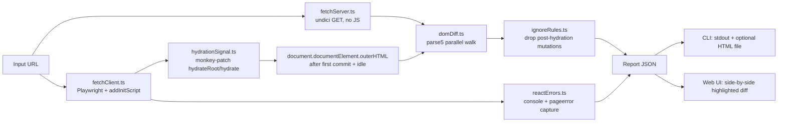

## Goal

Given a page URL, identify the differences between:

1. **Server HTML** — what the browser receives over the wire (JS disabled).
2. **Post-hydration DOM** — `documentElement.outerHTML` immediately after React's first hydration commit, before any user interaction.

…and report only the diffs React would treat as a hydration mismatch (tag / text / hydration-relevant-attribute / missing-or-extra-child mismatches), cross-referenced with any actual React #418/#423 errors thrown by the page.

## Tech stack

- **Node.js 20 + TypeScript** — single package, two entrypoints (CLI + web server).
- **Playwright (chromium)** — headless browser for the hydrated snapshot.
- **`undici`** (Node's native fetch) — for the no-JS server HTML fetch with realistic headers.
- **`parse5`** — spec-compliant HTML parser/serializer for the DOM diff.
- **`express`** — minimal web UI server.
- **`commander`** + **`kleur`** — CLI ergonomics.
- Web UI is intentionally **vanilla HTML/CSS/JS** (no React — keeps it diagnostic-grade and avoids dogfooding the very thing we're inspecting).

## Project layout

```
react-hydration-comparator/
  package.json                  # deps + bin + scripts
  tsconfig.json
  README.md
  src/
    core/
      types.ts                  # Mismatch, Report, FetchResult
      fetchServer.ts            # raw HTML via undici, no JS
      fetchClient.ts            # Playwright launcher + hydration snapshot + error capture
      hydrationSignal.ts        # addInitScript that hooks hydrateRoot/hydrate
      domDiff.ts                # parse5-based, React-semantics-aware tree diff
      ignoreRules.ts            # post-hydration mutations to skip (CSS-in-JS, analytics, etc.)
      reactErrors.ts            # console + pageerror filter for #418/#423
      compare.ts                # orchestrator: returns Report
      index.ts                  # public API
    cli/
      index.ts                  # bin entry: `react-hydrate-cmp <url> [--report file.html] [--json]`
      htmlReport.ts             # renders standalone HTML report
    web/
      server.ts                 # Express + POST /api/compare
      public/
        index.html              # URL input + result panel
        app.js                  # fetch → render side-by-side diff
        styles.css
  test/
    fixtures/                   # tiny HTML pairs for diff unit tests
    domDiff.test.ts
```

## Core flow



## Key design decisions

### 1. Why a custom DOM diff instead of `diff-dom` / text diff

A line-level text diff is unusable: attribute order, whitespace, and self-closing-tag normalization produce huge false-positive noise. `diff-dom` reports every change. We need React-semantic classification, so the diff itself filters by category:

- `tagMismatch` — same position, different `tagName`.
- `textMismatch` — corresponding text nodes with different normalized content.
- `missingChild` / `extraChild` — child present in one tree but not the other at the same parent slot.
- `attrMismatch` — only for the small set React hydrates against (see below).

### 2. Attribute filtering (the hard part)

Maintained allow-list of attributes React actually compares during hydration (`id`, `className`, `name`, `type`, `value`, `checked`, `selected`, `href`, `src`, `for`, `htmlFor`, plus `aria-*` and `data-*` that exist in *both* trees). Always-ignore set:

- `data-reactroot`, `data-reactid` (React-internal).
- Style/script attributes injected post-hydration (see §3).
- Browser-extension-injected attrs heuristically (`bis_*`, `cz-shortcut-listen`, etc.).
- `style` attribute is **compared** (React does flag this), but normalized for property order.

### 3. Post-hydration mutation suppression (`ignoreRules.ts`)

Things that legitimately appear only in the hydrated snapshot and are NOT hydration errors:

- `<style>` tags inside `<head>` injected by styled-components / emotion / linaria (heuristic: `data-emotion`, `data-styled`, `data-s`, or `<style>` with no server counterpart).
- `<script>` and `<iframe>` injected by analytics/ads (GTM, Segment, etc.) — match by `src` host allow-list + "appeared only on client" rule.
- Service worker / preload `<link>` injections.

These are detected as *extras* in the client tree at predictable positions and filtered before reporting. Configurable via `--ignore-selector` flag and `ignoreRules.ts` defaults.

### 4. "Hydration is done, no interaction yet"

Two-layer detection in `hydrationSignal.ts`, injected via `page.addInitScript` before any page script runs:

1. **Primary:** monkey-patch `ReactDOM.hydrateRoot` and `ReactDOM.hydrate` to wrap the returned root and resolve a `window.__hydrationDone` promise on first commit. Works for React 18 (`hydrateRoot`) and legacy (`hydrate`).
2. **Fallback:** if neither hook fires within a timeout, wait for `networkidle` + `requestIdleCallback` + 500ms buffer.

We never dispatch any input/click/scroll events. `page.evaluate` only reads `document.documentElement.outerHTML`.

### 5. Capturing real React errors (`reactErrors.ts`)

Subscribe to `page.on('console')` and `page.on('pageerror')` *before* navigation. Match:

- Stack/message containing `Minified React error #418` or `#423`.
- Dev-mode messages: `Hydration failed because`, `Text content did not match`, `Expected server HTML to contain`, `Did not expect server HTML to contain`, `Prop \`...\` did not match`.

Each captured error becomes a `ReactHydrationError` entry alongside the structural `Mismatch[]` so the report shows both "what React told us" and "what we found by diffing".

## Report shape

```ts
type Report = {
  url: string;
  fetchedAt: string;
  serverStatus: number;
  reactErrors: ReactHydrationError[];      // captured from console/pageerror
  mismatches: Mismatch[];                  // structural, classified
  summary: { tagMismatches: number; textMismatches: number; attrMismatches: number; missingChildren: number; extraChildren: number; reactErrorCount: number };
  raw: { serverHtml: string; clientHtml: string }; // for side-by-side rendering
};

type Mismatch =
  | { kind: 'tag'; path: string; server: string; client: string }
  | { kind: 'text'; path: string; server: string; client: string }
  | { kind: 'attr'; path: string; attr: string; server: string | null; client: string | null }
  | { kind: 'missingChild'; path: string; expected: string }   // in server, not in client
  | { kind: 'extraChild'; path: string; found: string };       // in client, not in server
```

`path` is a CSS-selector-like address (`html > body > div:nth-child(2) > main > h1`) for human readability.

## CLI surface

```bash
react-hydrate-cmp https://example.com/page
react-hydrate-cmp https://example.com/page --json > report.json
react-hydrate-cmp https://example.com/page --report report.html
react-hydrate-cmp https://example.com/page --serve   # boots web UI on :4321
react-hydrate-cmp https://example.com/page --ignore-selector ".intercom-frame" --timeout 30000
```

Exit code: `0` if no hydration mismatches and no React errors, `1` otherwise — useful for CI.

## Web UI

Single page served by Express:

- URL input + "Compare" button.
- Loading state while Playwright runs.
- Summary card (counts + React error badges).
- Tabbed result view:
  - **Mismatches** — table grouped by kind, each row links to highlight location in HTML panes.
  - **Side-by-side** — server HTML and client HTML in two `<pre>` panes with synchronized scroll; mismatched ranges highlighted (red for server-only, green for client-only, yellow for changed).
  - **React errors** — raw captured messages.

`POST /api/compare { url }` returns the `Report` JSON; the page renders it client-side. No DB, no auth — local dev tool.

## Edge cases handled up front

- Auth-gated pages — flag `--cookie` / `--header` for both fetcher and Playwright `extraHTTPHeaders`.
- Streaming SSR (React 18 Suspense) — wait for all `<template>` placeholders to resolve before snapshotting (detect via MutationObserver in init script).
- `<noscript>` — only present in server HTML when JS is disabled; React strips them on hydration → explicitly ignored.
- Charset/encoding — both fetchers honor `Content-Type` and decode with `TextDecoder`.

## Out of scope (explicitly)

- Visual/pixel diffing — text/DOM only.
- Persisting reports server-side / multi-user web UI.
- Diffing multiple URLs in one run (easy follow-up).
- Auto-fixing or suggesting fixes for detected mismatches.
